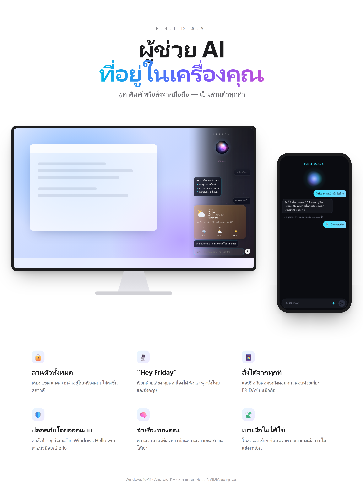
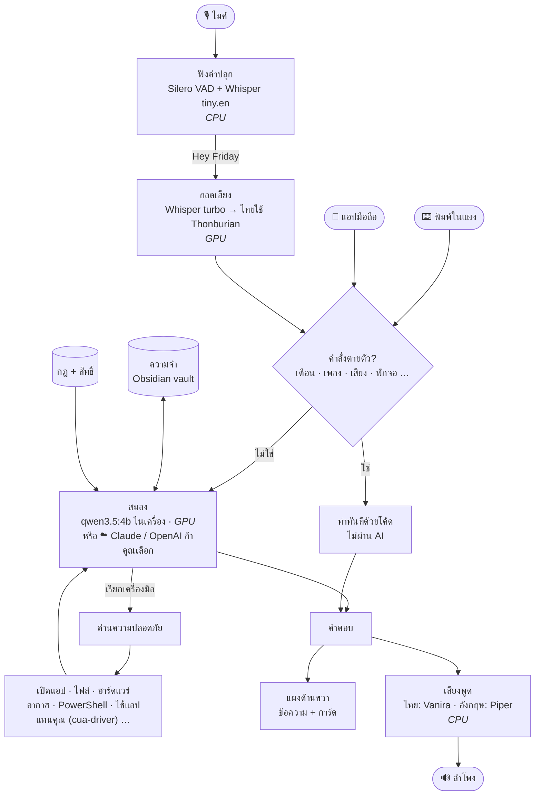
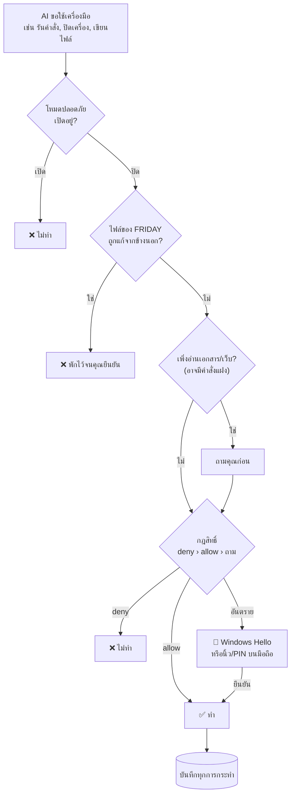
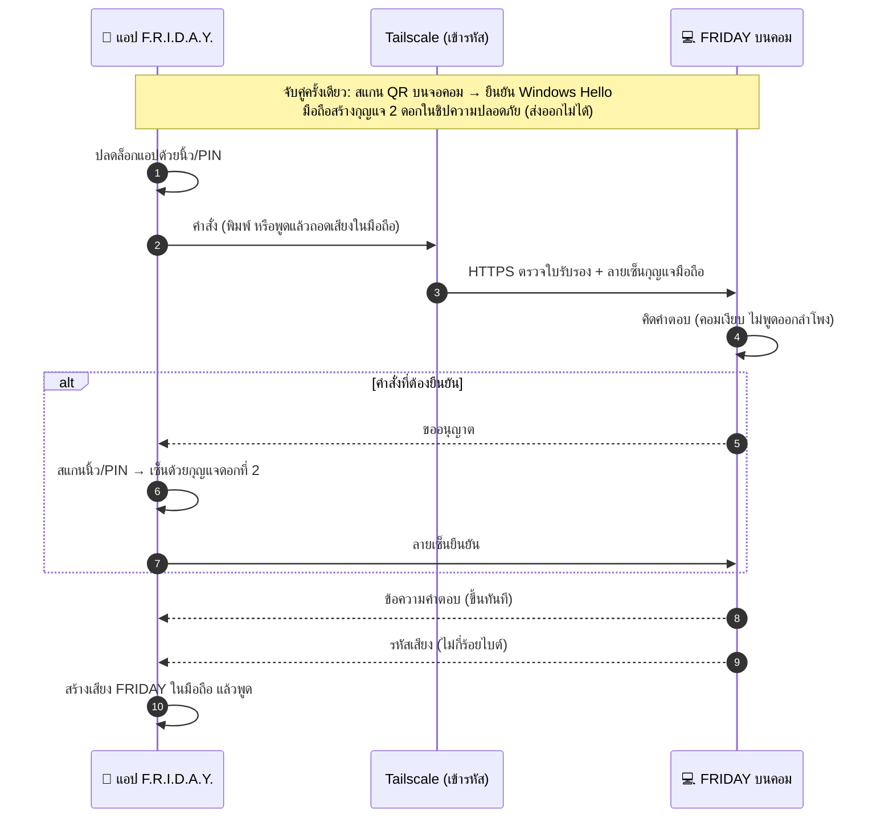

# F.R.I.D.A.Y.

<p align="center"></p>

ผู้ช่วย AI ส่วนตัวแบบ JARVIS ที่**ทำงานในคอมพิวเตอร์ของคุณเอง** — เรียกด้วยเสียง "Hey Friday" หรือพิมพ์ ·
พูดและฟังได้ทั้งไทยและอังกฤษ · จำเรื่องของคุณ · ช่วยเปิดโปรแกรม เตือนความจำ คุมเพลง และอื่นๆ อีกมาก ·
สั่งจากมือถือได้เมื่ออยู่นอกบ้าน · เปลี่ยน"สมอง"เป็น Claude หรือ OpenAI ได้ โดยความจำและตัวตนยังเหมือนเดิม

**เป็นส่วนตัว** — เสียง ข้อความ และความจำของคุณอยู่ในเครื่องคุณเท่านั้น ไม่ส่งไปคลาวด์
(ยกเว้นพยากรณ์อากาศ ที่ส่งไปแค่ชื่อเมือง/พิกัด · และสมองบนคลาวด์ ถ้าคุณเลือกใช้เอง) · ไม่กินเครื่องตอนไม่ได้ใช้

---

## เครื่องที่ต้องมี

| | ขั้นต่ำ | แนะนำ |
|---|---|---|
| ระบบ | Windows 10 (21H2) / 11 แบบ 64 บิต | Windows 11 |
| การ์ดจอ | ไม่มีก็ใช้ได้ (ช้า) | NVIDIA 8 GB ขึ้นไป (เช่น RTX 3060 12 GB) |
| หน่วยความจำ | 16 GB | 32 GB |
| พื้นที่ว่าง | 15 GB | 20 GB |
| อื่นๆ | ไมค์ + ลำโพง · อินเทอร์เน็ตตอนติดตั้ง | ตั้ง Windows Hello (PIN/ลายนิ้วมือ/ใบหน้า) ไว้ |

## ติดตั้ง

1. ดาวน์โหลด **`FRIDAY-Setup-<เวอร์ชัน>.exe`** และ **`FRIDAY-Setup-<เวอร์ชัน>-1.bin`** จากหน้า [Releases](../../releases) ไว้ในโฟลเดอร์เดียวกัน แล้วเปิดไฟล์ `.exe` — ไม่ต้องใช้สิทธิ์ผู้ดูแลระบบ
2. กดถัดไปจนจบ ตัวติดตั้งจะ:
   - ติดตั้ง F.R.I.D.A.Y.
   - ติดตั้ง **Ollama** (ตัวรันโมเดลภาษา) ถ้ายังไม่มี
   - ดาวน์โหลด**สมองของ FRIDAY** (~3.4 GB — มีหน้าต่างดำแสดงความคืบหน้า) และ**โมเดลฟังเสียง** (~3 GB)
   - ตั้งให้ FRIDAY เปิดเองตอนเข้าสู่ระบบ และสร้างทางลัด **Ctrl+Alt+J**
   - (ถ้าติ๊ก) ติดตั้ง **cua-driver** ให้ FRIDAY ใช้แอปแทนคุณได้ — ดูหัวข้อ [ให้ FRIDAY ใช้แอปแทนคุณ](#ให้-friday-ใช้แอปแทนคุณ-cua-driver)
3. ใช้เวลาประมาณ 10–30 นาที ขึ้นกับความเร็วเน็ต

## เริ่มใช้

- FRIDAY อยู่ที่**ไอคอนวงกลมมุมขวาล่าง** (system tray — ถ้าไม่เห็น กดลูกศร `^`)
- **พูด "Hey Friday"** (ออกเสียงแบบอังกฤษ) แล้วสั่งต่อได้เลย คุยต่อเนื่องได้โดยไม่ต้องเรียกซ้ำ · เงียบสักพักหรือพูด "พอแล้ว" = พัก
- **คลิกไอคอน** หรือกด **Ctrl+Alt+J** = เปิดแผงพิมพ์ด้านขวา
- **คลิกขวาไอคอน** = เมนู (หยุด · ระดับเสียง · สมอง · มือถือ · ความปลอดภัย · ออก)

### ตัวอย่างคำสั่ง

| อยากทำ | พูด/พิมพ์ |
|---|---|
| ถามอะไรก็ได้ | "อธิบายเรื่องนี้ให้หน่อย" · "แปลเป็นอังกฤษ" |
| เตือน / ปลุก / จับเวลา | "อีก 10 นาทีเตือนเอาผ้าออก" · "ปลุกตี 6" · "จับเวลา 25 นาที" |
| งานที่ต้องทำ | "เพิ่มงานส่งรายงานวันศุกร์" · "วันนี้มีงานอะไรบ้าง" |
| เพลง (YouTube · YouTube Music · Spotify · Media Player …) | "เพลงต่อไป" · "หยุด spotify" · "สุ่มเพลง" · "ย้อนกลับ 10 วิ" · "เปิดเพลง ลาลาลอย ใน youtube music" · "เพลงนี้ชื่ออะไร" |
| เครื่อง | "เสียงเบาลง" · "พักจอ" · "เปิดจอ" · "สลับไป vscode" · "ดูหน้าจอหน่อย" |
| อากาศ | "วันนี้อากาศเป็นยังไง" · "พรุ่งนี้เชียงใหม่ฝนตกไหม" |
| ไฟล์ | "หาไฟล์ที่พูดถึง งบประมาณ" · "อ่านที่ก๊อปให้ฟัง" · "สรุปที่ก๊อปไว้" |
| ความจำ | "จำไว้ว่าฉันแพ้ถั่ว" · "ฉันแพ้อะไรนะ" |
| ใช้แอปแทนคุณ | "พิมพ์ว่า ประชุมบ่ายสาม ใน notepad" · "กดปุ่ม Save ใน notepad" (ต้องติดตั้ง cua-driver) |
| โปรเจกต์ | "เปิดโปรเจกต์ E:\work\myapp" · "แก้ฟังก์ชัน add" · "รันเทสให้หน่อย" · "ออกจากโปรเจกต์" |
| สมอง | "เปลี่ยนสมองเป็น claude" · "ใช้สมองในเครื่อง" · "โหลดโมเดล gemma3:4b" · "ตอนนี้ใช้สมองอะไร" |
| อื่นๆ | "สรุปวันนี้" · "โหมดโฟกัส 45 นาที" · "เริ่มแปลสด" · "ล้างแชท" · "ปิดโปรแกรม" |

- **หยุดทันที**: พูด "หยุด" · กดปุ่ม ■ ในแผง · หรือพูด "Hey Friday" แทรกระหว่างที่ FRIDAY พูด
- **ให้ตอบเฉพาะเสียงคุณ**: พูด "ลงทะเบียนเสียง" แล้วอ่าน 5 ประโยคตามที่ขึ้น

**รายละเอียดในแผง:** ข้อความสั้นๆ ของสิ่งที่ FRIDAY ทำ (อ่านไฟล์ · แก้ไฟล์ · คำถามยืนยัน · ตรวจบท) มีลิงก์ **ดูรายละเอียด** — เปิดแชต (คลิกไอคอน) แล้วกดลิงก์เพื่อกางดูเนื้อหาเต็ม กดอีกทีเพื่อซ่อน

**ที่อยู่ไฟล์ในแชตกดได้:** ถ้า FRIDAY ตอบเป็นที่อยู่ไฟล์หรือโฟลเดอร์ (เช่น `C:\Users\…\video.mp4`) ข้อความจะเป็นลิงก์ — กดแล้วเปิด File Explorer ที่โฟลเดอร์นั้นและเลือกไฟล์ไว้ให้ (ไม่เปิดหรือรันไฟล์เอง)

### มีหลายจอ — เลือกจอของแผงแชต

คลิกขวาไอคอน → **จอของแผงแชต** → **จอหลัก** (ค่าเริ่มต้น) · **จอที่เมาส์อยู่** (แผงขึ้นที่จอที่คุณกำลังใช้) · หรือ **จอ 1 / จอ 2 …** (นับจากซ้ายไปขวา)
— หรือพูด/พิมพ์ **"ย้ายแผงไปจอ 2"** · **"แผงแชตไปจอหลัก"** · **"ให้แผงอยู่จอที่เมาส์อยู่"** · FRIDAY จำไว้ เปิดใหม่ก็ยังอยู่จอเดิม (ถอดจอนั้นออก = กลับจอหลัก)

## สั่งจากมือถือ (Android 11 ขึ้นไป)

1. ติดตั้ง **Tailscale** ทั้งบนคอมและมือถือ แล้ว login บัญชีเดียวกัน (ใช้ต่อมือถือกับคอมแบบเข้ารหัส ไม่ต้องตั้งเราเตอร์)
2. ติดตั้งแอป **F.R.I.D.A.Y.** (`FRIDAY-remote.apk`) บนมือถือ
3. ที่คอม: คลิกขวาไอคอน → **มือถือ** → **จับคู่มือถือ…** (ครั้งแรก Windows จะถามอนุญาตเปิดพอร์ต)
4. ในแอปกด **สแกน QR** → ยืนยันด้วย Windows Hello ที่คอม

จากนั้นพิมพ์หรือกด 🎙 พูดสั่งได้จากทุกที่ — คำตอบออกเสียงที่มือถือ (คอมเงียบ) · อะไรที่อันตราย มือถือจะขอสแกนนิ้ว/PIN ก่อน ·
มือถือหาย: คลิกขวาไอคอนบนคอม → มือถือ → ลบ

## เปลี่ยนสมอง (โมเดลที่คิดและตอบ)

ค่าเริ่มต้นคือสมองในเครื่อง (`qwen3.5:4b`) — เปลี่ยนเป็นโมเดลอื่นได้ โดย**ตัวตน ความจำ กฎ และประวัติแชตยังเหมือนเดิม** (เปลี่ยนแค่ "ใครคิด")

| สมอง | ข้อดี | ข้อควรรู้ |
|---|---|---|
| **ในเครื่อง** (Ollama — รุ่นไหนก็ได้ที่ติดตั้งไว้) | ไม่มีอะไรออกนอกเครื่อง · ฟรี | ฉลาดเท่าที่การ์ดจอรับไหว |
| **Claude** (Anthropic) | ฉลาดกว่ามาก · ดูภาพหน้าจอเก่ง | ต้องมี API key (เสียค่าใช้จ่ายตามการใช้) · แชตออกนอกเครื่อง |
| **OpenAI** (GPT) | ฉลาดกว่ามาก | ต้องมี API key (เสียค่าใช้จ่ายตามการใช้) · แชตออกนอกเครื่อง |

**วิธีใช้**
1. คลิกขวาไอคอน → **สมอง** → **☁ Claude — ใส่ API key…** (หรือ OpenAI) → วาง key → ยืนยันด้วย Windows Hello
2. คลิกขวาไอคอน → **สมอง** → **☁ Claude** → เลือกรุ่น → ยืนยันด้วย Windows Hello
3. หรือพูด/พิมพ์ **"เปลี่ยนสมองเป็น claude"** · **"ใช้สมองในเครื่อง"** · **"ตอนนี้ใช้สมองอะไร"**

**เมื่อใช้สมองบนคลาวด์**
- แผงขึ้น **☁ ชื่อโมเดล** ใต้ชื่อ F.R.I.D.A.Y. ตลอดเวลา — รู้เสมอว่าแชตกำลังออกนอกเครื่อง
- **ส่งออก:** ข้อความแชต · ตัวตนและกฎ · รายชื่อหมวดความจำ (ใช้เลือกโน้ต) · โน้ตความจำที่เกี่ยวกับคำถามนั้น
- **ถามก่อนทุกครั้ง:** ภาพหน้าจอ · เนื้อหาเอกสาร · ข้อความที่ก๊อป
- **ไม่ส่ง:** เอกสารของคุณใน vault (ส่งเฉพาะโน้ตความจำ) · เนื้อหาเอกสารที่เคยอ่านในรอบก่อนๆ · เสียงของคุณ (ถอดเสียงในเครื่องเสมอ)
- คลาวด์ใช้ไม่ได้ (เน็ตหลุด · เครดิตหมด · key ผิด) → **ตอบด้วยสมองในเครื่องแทน** และบอกสาเหตุ
- API key เก็บเข้ารหัสในเครื่อง (Windows DPAPI) — ไม่อยู่ในไฟล์ตั้งค่า ไม่ขึ้นในบันทึก
- ด่านความปลอดภัยทั้งหมดยังอยู่ในเครื่อง — สมองบนคลาวด์ข้ามด่านไม่ได้เหมือนกัน

### ใช้โมเดลอื่นในเครื่อง (โหลดเข้า Ollama)

เปลี่ยนสมองในเครื่องเป็นโมเดลอื่นจาก [ollama.com/library](https://ollama.com/library) ได้โดยไม่ต้องเปิด Terminal ·
ทุกอย่างยังอยู่ในเครื่องเหมือนเดิม

**โหลดโมเดลใหม่**
1. หาชื่อโมเดลที่ [ollama.com/library](https://ollama.com/library) ในรูปแบบ `ชื่อ:ขนาด` เช่น `gemma3:4b` · `qwen3:8b` · `llama3.2:3b`
2. พิมพ์หรือพูด **"โหลดโมเดล gemma3:4b"**
   หรือคลิกขวาไอคอน → **สมอง** → **⬇ โหลดโมเดลจาก Ollama…** → ใส่ชื่อ → **บันทึก**
3. ตอบ **ใช่** เมื่อ FRIDAY ถามว่าจะดาวน์โหลดไหม (โมเดลมักใหญ่หลาย GB ต้องต่ออินเทอร์เน็ต)
4. ดูความคืบหน้าในแผง (ขึ้นทุก 25%) · ระหว่างนี้คุยกับ FRIDAY ได้ตามปกติ
5. โหลดเสร็จ FRIDAY เปลี่ยนสมองเป็นโมเดลนั้นให้เอง และแจ้งขนาดไฟล์

**สลับระหว่างโมเดลที่มีแล้ว**
- พิมพ์หรือพูด **"เปลี่ยนสมองเป็น gemma3:4b"** · กลับไปตัวเริ่มต้น: **"เปลี่ยนสมองเป็น qwen3.5:4b"**
- **"ใช้สมองในเครื่อง"** = กลับมาใช้โมเดลในเครื่องตัวล่าสุดที่ใช้ (เช่น หลังจากใช้ Claude)
- หรือคลิกขวาไอคอน → **สมอง** → เลือกจากรายชื่อ "ในเครื่อง · …" (✓ = ตัวที่ใช้อยู่)

**เลือกขนาดให้พอดีการ์ดจอ**

| การ์ดจอ (VRAM) | ขนาดโมเดลที่แนะนำ | ตัวอย่าง |
|---|---|---|
| 8 GB | ไม่เกิน ~4B | `gemma3:4b` · `llama3.2:3b` · `qwen3.5:4b` (ค่าเริ่มต้น) |
| 12 GB | ไม่เกิน ~8B | `qwen3:8b` · `llama3.1:8b` |
| 16 GB ขึ้นไป | ใหญ่กว่านั้นได้ | `gemma3:12b` · `qwen3:14b` |

- FRIDAY ใช้การ์ดจอกับระบบฟังเสียงด้วย ไฟล์โมเดลที่ใหญ่กว่า ~7.5 GB จึงมี**คำเตือน** · ถ้าใหญ่เกินจะตอบช้าลงและแย่งการ์ดจอกับงานอื่น
- โมเดลต้อง**รองรับการเรียกเครื่องมือ (tools)** ถึงจะสั่งงานเครื่องได้ · ดูป้าย `tools` ที่หน้าโมเดลใน ollama.com
- โมเดลอื่นยังไม่ได้วัดว่าเข้าใจภาษาไทยดีแค่ไหน · ถ้าเรียกใช้ไม่ได้ FRIDAY จะตอบด้วย `qwen3.5:4b` แทน และบอกสาเหตุ

**ลบโมเดลที่ไม่ใช้** (คืนพื้นที่ดิสก์): เปิด PowerShell แล้วพิมพ์ `ollama rm gemma3:4b` · ดูรายชื่อที่มี: `ollama list`

## ให้ FRIDAY ใช้แอปแทนคุณ (cua-driver)

FRIDAY อ่านปุ่มและช่องข้อความในหน้าต่างของแอป แล้วกดหรือพิมพ์ให้ **อยู่เบื้องหลัง**: เมาส์และคีย์บอร์ดของคุณไม่ขยับ และหน้าต่างไม่เด้งขึ้นมาบังงาน
ใช้ [cua-driver](https://cua.ai/docs/cua-driver) (MIT, รุ่น 0.37.0)

1. ติดตั้ง — เลือกทางใดทางหนึ่ง (ทั้งสองทางไม่ส่งสถิติการใช้งาน และไม่ตั้งให้เปิดเองตอน login):
   - **ตอนติดตั้ง FRIDAY:** ติ๊ก "ติดตั้ง cua-driver…" (ติดตั้งซ้ำทับของเดิมได้ ถ้าลง FRIDAY ไว้แล้ว)
   - **ติดตั้งเอง** ใน PowerShell (ไม่ต้องใช้สิทธิ์ผู้ดูแลระบบ):
   ```powershell
   $env:CUA_DRIVER_RS_TELEMETRY_ENABLED='false'
   irm https://cua.ai/driver/install.ps1 -OutFile $env:TEMP\cua-install.ps1
   powershell -ExecutionPolicy Bypass -File $env:TEMP\cua-install.ps1 -NoAutoStart
   cua-driver telemetry disable
   ```
2. สั่งได้เลย เช่น "พิมพ์ว่า … ใน notepad"
   - แอปแรกที่ FRIDAY จะใช้ในแต่ละงาน ต้องยืนยันด้วย **Windows Hello** หนึ่งครั้ง
   - หลังจากนั้น FRIDAY กดหรือพิมพ์ในแอปนั้นได้เองจนจบคำสั่งนั้น ถ้าจะไปใช้แอปอื่นต้องยืนยันใหม่
   - สั่งครั้งถัดไปต้องยืนยันใหม่ · กด "หยุด" แล้ว FRIDAY ปล่อยแอปทันที

- **กดคีย์ได้เฉพาะชุดที่อนุญาต:** Enter · Tab · ลูกศร · ตัวอักษร พร้อม Ctrl/Shift/Alt
  - **ไม่มี** ปุ่ม Win · Ctrl+Alt · Alt+F4
  - ปิดโปรแกรม สั่งสคริปต์ และดาวน์โหลดไฟล์ ไม่ได้
  - ไม่พิมพ์ใน Terminal / PowerShell / Command Prompt / Registry Editor / Task Manager — คำสั่งระบบต้องผ่านทางที่ถาม Windows Hello ทุกคำสั่ง
- **สมองบนคลาวด์:** ข้อความบนหน้าต่างจะส่งไปให้สมองบนคลาวด์ ซึ่งบอกไว้ในคำถาม Windows Hello แล้ว · FRIDAY ไม่ส่งภาพหน้าจอ
- **สมองในเครื่อง** (`qwen3.5:4b`):
  - งานขั้นเดียว ("พิมพ์ … ใน notepad") สำเร็จ 3/3 ครั้ง ใช้เวลาครั้งละประมาณ 6 วินาที
  - งานหลายขั้นพลาดบ้าง — งานยาวใช้ Claude ดีกว่า

## โปรเจกต์ — ให้ FRIDAY ทำงานในโฟลเดอร์งานของคุณ

คล้าย Claude Code หรือ Codex: เปิดโฟลเดอร์โปรเจกต์ แล้ว FRIDAY อ่าน ค้นหา แก้ไฟล์ และรันคำสั่ง **ได้เฉพาะในโฟลเดอร์นั้น**

**เปิด / ปิด**
- พิมพ์หรือพูด **"เปิดโปรเจกต์ E:\work\myapp"** · **"เปิดโปรเจกต์ myapp"** (ชื่อโปรเจกต์ที่เคยเปิด) · **"เปิดโปรเจกต์ล่าสุด"**
- หรือคลิกขวาไอคอน → **โปรเจกต์** → เลือกจากรายการ หรือ **เลือกโฟลเดอร์…**
- **"ตอนนี้อยู่โปรเจกต์อะไร"** · **"ออกจากโปรเจกต์"**
- แผงขึ้นป้าย **📁 ชื่อโปรเจกต์** ตลอดที่เปิดอยู่ · ปิด FRIDAY แล้วเปิดใหม่ โปรเจกต์ยังเปิดค้างไว้

**สั่งอะไรได้บ้าง (ตัวอย่าง)**
- "ในโปรเจกต์นี้มีไฟล์อะไรบ้าง" · "ฟังก์ชัน login อยู่ไฟล์ไหน" · "อธิบายไฟล์ src/app.py"
- "แก้ฟังก์ชัน add ให้รับ 3 ตัวเลข" — FRIDAY บอกในแผงว่าแก้กี่บรรทัด · กด **ดูรายละเอียด** เพื่อดู diff เต็ม
- "รันเทสด้วย npm test" · "build ให้หน่อย" — คำสั่งรันในโฟลเดอร์โปรเจกต์ ผลลัพธ์กลับมาให้ FRIDAY อ่าน
- "โปรเจกต์มีอะไรเปลี่ยนบ้าง" — git status ของโปรเจกต์ที่เปิดอยู่ (อ่านอย่างเดียว)

**ความปลอดภัย**
- แก้ไฟล์หรือรันคำสั่งครั้งแรกในแต่ละคำสั่งของคุณ ต้องยืนยันด้วย **Windows Hello** หนึ่งครั้ง (สั่งจากมือถือ = นิ้ว/PIN บนมือถือ) แล้วทำต่อได้จนจบคำสั่งนั้น
- ถ้า FRIDAY เพิ่งอ่านไฟล์ในคำสั่งนั้น **ทุกคำสั่งที่จะรันต้องยืนยันใหม่** — กันข้อความในไฟล์แอบสั่งให้รันอะไร
- ออกนอกโฟลเดอร์ไม่ได้ (`..` · path เต็มที่อื่น · symlink/junction) · ไม่แตะ `.git` ภายใน · **ไม่อ่านไฟล์ลับ** (`.env` · `*.key` · `*.pem` · `id_rsa` · ชื่อที่มี secret/credential)
- กฎ deny ใน `settings.json` ใช้ได้: `ProjectRun(...)` · `ProjectEdit(...)` และกฎ `PowerShell(...)` เดิมก็มีผลกับคำสั่งในโปรเจกต์
- คำสั่งที่ทำงานนานเกิน 2 นาที (เช่น dev server) ถูกหยุดพร้อมโปรแกรมลูกทั้งหมด

**อื่นๆ**
- **ไฟล์คำสั่งประจำโปรเจกต์:** ถ้าที่รากมี `FRIDAY.md` · `CLAUDE.md` · `AGENTS.md` FRIDAY อ่านเป็นคำสั่งเพิ่มของโปรเจกต์นั้นเอง
- **แชตแยกต่อโปรเจกต์:** แต่ละโปรเจกต์มีประวัติแชตของตัวเอง · ความจำของคุณใช้ร่วมกันทุกโปรเจกต์
- **สมองบนคลาวด์:** ครั้งแรกที่ใช้โปรเจกต์กับ Claude/OpenAI จะถามด้วย Windows Hello ว่ายอมส่งไฟล์โปรเจกต์นี้ไหม (ถามครั้งเดียวต่อโปรเจกต์) · ไม่ยอม = คลาวด์ไม่เห็นโปรเจกต์เลย ต้องใช้สมองในเครื่อง
- **สมองในเครื่อง (`qwen3.5:4b`):** งานในโปรเจกต์ทดสอบ (ดูไฟล์ · หาฟังก์ชัน · อธิบาย · แก้ · รันเทส) ผ่าน 10/10 ใช้เวลาประมาณ 4 วินาที · งานแก้โค้ดใหญ่ๆ หลายไฟล์ใช้ Claude ดีกว่า
- โฟลเดอร์ที่กว้างเกินไปเปิดเป็นโปรเจกต์ไม่ได้: รากไดรฟ์ (`C:\`) · Windows · Program Files · โฟลเดอร์ผู้ใช้ทั้งก้อน

### หมวดหมู่โปรเจกต์ — ตั้งกฎให้ FRIDAY ตามงาน (คล้าย Gems ของ Gemini)

แต่ละโปรเจกต์เลือก **หมวด** ได้ แล้ว FRIDAY ทำงานตามกฎของหมวดนั้น (บทบาท · วิธีทำงาน · ไฟล์ที่ใช้เก็บงาน) · ทุกหมวดใช้ tool ได้ครบเหมือนกัน

| หมวด | FRIDAY ทำอะไร |
|---|---|
| เขียนโค้ด | อ่านก่อนแก้ · ตามสไตล์เดิมของโปรเจกต์ · รันเทสหลังแก้ |
| สร้างเกม | เก็บดีไซน์ใน `GAME.md` · ทำต้นแบบเล็กที่เล่นได้ก่อน แล้วเพิ่มทีละกลไก |
| วางแผนการตลาด | แผนใน `plan.md` (กลุ่มลูกค้า · ช่องทาง · ไทม์ไลน์ · งบ · KPI) · ไอเดียคอนเทนต์ใน `content.md` · ไม่แต่งตัวเลขตลาด |
| เขียนนิยาย | story bible (`characters.md` `world.md` `outline.md`) · บทละไฟล์ `chapters/01.md` · ถามก่อนเปลี่ยนพล็อตใหญ่ |
| ทำวิดีโอ | วิดีโอโปรโมท/เล่าเรื่อง — ดูหัวข้อ "ทำวิดีโอ" ด้านล่าง |
| ทำเอกสาร/รายงาน · วิจัย/สรุปข้อมูล · ออกแบบ UX/UI · เรียน/ติว | กฎตามงานนั้นๆ |

**สั่งได้แบบนี้**
- **"สร้างโปรเจกต์นิยาย ชื่อ ดาวพระศุกร์"** — สร้างโฟลเดอร์ใน `Documents\FRIDAY\Projects\` พร้อมกฎหมวด แล้วเปิดให้ทันที
- **"ตั้งหมวดโปรเจกต์เป็นการตลาด"** — เปลี่ยนหมวดของโปรเจกต์ที่เปิดอยู่ · **"มีหมวดอะไรบ้าง"**
- **"สร้างหมวด บทพากย์ YouTube กฎ เขียนสคริปต์สั้น กระชับ เป็นกันเอง"** — หมวดของคุณเอง · **"ลบหมวด บทพากย์ YouTube"**
- หรือคลิกขวาไอคอน → **โปรเจกต์** → **สร้างโปรเจกต์ใหม่…** (ตั้งชื่อ + เลือกหมวด) · **หมวดของโปรเจกต์นี้** → เลือก
- แผงขึ้นป้าย **📁 ชื่อโปรเจกต์ · หมวด**

**ข้อควรรู้**
- กฎหมวดเขียนไว้ใน `FRIDAY.md` ของโปรเจกต์ ในบล็อก `<!-- friday:category … -->` — แก้กฎเองได้ในไฟล์ · ข้อความที่คุณเขียนนอกบล็อกไม่ถูกแตะเมื่อเปลี่ยนหมวด
- สร้างโปรเจกต์ · เปลี่ยนหมวด · สร้าง/ลบหมวด ต้องยืนยันด้วย **Windows Hello**
- สมองในเครื่อง (`qwen3.5:4b`) ทำงานตามหมวดได้ 3/4 ในการทดสอบ (นิยาย 1/2 · แผนการตลาด 2/2) · งานเขียนยาวๆ ใช้ Claude จะดีกว่า

## ทำวิดีโอ — โปรโมทหรือเล่าเรื่อง

FRIDAY ทำวิดีโอสั้นได้แบบที่ Claude Code ทำด้วย skill [/brag](https://github.com/latent-spaces/brag): ภาพเคลื่อนไหวสร้างด้วย CSS + JavaScript
เพลงประกอบสร้างในเครื่อง และพากย์ด้วยเสียงของ FRIDAY เอง · ทุกอย่างทำในเครื่องนี้

**ก่อนใช้ครั้งแรก:** ติดตั้ง ffmpeg (ตัวรวมภาพ + เสียงเป็น mp4) — เปิด PowerShell แล้วพิมพ์ `winget install Gyan.FFmpeg` · ต้องมี Microsoft Edge (มากับ Windows)

**สั่งได้แบบนี้**
- **"ทำวิดีโอโปรโมทร้านกาแฟเปิดใหม่ชื่อ ดอยช้าง คอฟฟี่ ที่นิมมาน ยาว 20 วิ"**
- **"ทำวิดีโอเล่าเรื่องแมวส้มที่หลงทางแล้วหาทางกลับบ้าน แนวอบอุ่น แนวตั้งสำหรับ TikTok"**
- **"หยุดทำวิดีโอ"** — ยกเลิกระหว่างทำ

**ขั้นตอน**
1. ถ้ายังไม่ได้เปิดโปรเจกต์ FRIDAY สร้างโปรเจกต์หมวด **ทำวิดีโอ** ใน `Documents\FRIDAY\Projects\` ให้ (ยืนยันด้วย Windows Hello)
2. FRIDAY เขียน `storyboard.json` (ฉาก · ข้อความบนจอ · บทพากย์ · โทน · เพลง) ลงในโปรเจกต์
3. หน้าต่างแสดงรายการฉากให้ดูก่อน → กด **Yes** ถ้าโอเค
4. FRIDAY ทำวิดีโอเบื้องหลัง (ความคืบหน้าในแผง) · เสร็จแล้วแจ้ง (และแจ้งมือถือ) · ไฟล์ชื่อ `video-<วันเวลา>.mp4` ในโฟลเดอร์โปรเจกต์ ไม่ทับไฟล์เดิม

**ปรับแต่ง:** บอก FRIDAY ให้แก้ฉาก/โทน/ความยาวแล้วทำใหม่ หรือแก้ `storyboard.json` เอง แล้วพูด "ทำวิดีโอจาก storyboard ใหม่"

| ตั้งค่า | เลือกได้ |
|---|---|
| ขนาด (`format`) | `landscape` 1920×1080 (YouTube) · `vertical` 1080×1920 (Reels/TikTok) · `square` 1080×1080 |
| โทน (`tone`) | `default` · `polished` · `cinematic` · `chaotic` · `deadpan` · `app-store` · `dark` |
| เพลง (`mood`) | `bright` · `calm` · `epic` · `none` |
| ฉาก (`type`) | `title` หัวเรื่อง · `lines` ข้อความทีละบรรทัด · `cards` การ์ดรายการ · `stat` ตัวเลขนับขึ้น (ลงท้าย % = วงแหวนเกจ) · `quote` คำพูด · `image` รูปในโปรเจกต์ · `outro` ปิดท้าย |
| Infographic | `bars` กราฟแท่ง · `donut` วงกลมสัดส่วน · `line` กราฟเส้น — ใส่ `"data": [{"label": "ลาเต้", "value": 420}]` + `"unit"` · `steps` ขั้นตอน/ไทม์ไลน์ (`"2024: เปิดร้าน"`) · `icons` ไอคอน emoji + ป้าย (`"☕ คั่วเองทุกวัน"`) |

- **ตัวเลข → กราฟเอง:** บอกตัวเลขของคุณในคำสั่ง (เช่น "ลาเต้ขายได้ 420 แก้ว มอคค่า 310 โกโก้ 250 · ลูกค้าในพื้นที่ 55% นักท่องเที่ยว 45%") — ตัวเลขหลายตัวหน่วยเดียวกันกลายเป็นกราฟแท่ง · เปอร์เซ็นต์ที่รวมได้ 100 กลายเป็นวงกลมสัดส่วนให้อัตโนมัติ · FRIDAY ไม่แต่งตัวเลขเอง
- **ใส่รูปของคุณ:** วางรูป (png/jpg/webp) ในโฟลเดอร์โปรเจกต์ แล้วบอก FRIDAY ให้ใช้ — รูปที่ไม่มีอยู่จริงจะกลายเป็นฉากข้อความแทน
- **สมองเก่ง (Claude):** เขียนหน้าเว็บ `video.html` ทั้งหน้าเองได้ (ทุกเฟรมวาดจาก `window.T(วินาที)`) แล้ว FRIDAY ถ่ายทีละเฟรมให้
- **ความปลอดภัย:** หน้าเว็บของวิดีโอเปิดใน Edge แบบซ่อน **ไม่มีอินเทอร์เน็ต** และเห็นได้เฉพาะไฟล์ในโปรเจกต์ — โหลดไฟล์อื่นในเครื่องหรือส่งอะไรออกไปไม่ได้
- **ทรัพยากร:** ทำงานแบบ priority ต่ำ ไม่ใช้การ์ดจอ (ทดสอบ: วิดีโอ 12 วิ ใช้ 32 วิ · CPU เฉลี่ย 22%) · เสร็จแล้วปิด Edge/ffmpeg หมด
- **สมองในเครื่อง (`qwen3.5:4b`):** ทดสอบ โปรโมท 2/2 · เล่าเรื่อง 2/2 ได้วิดีโอจริงครบ (คิด ~9 วิ + ทำวิดีโอ ~40 วิ)
- ฟอนต์ [Prompt](https://fonts.google.com/specimen/Prompt) (OFL) · แนวคิดและกฎการเล่าเรื่องจาก [/brag](https://github.com/latent-spaces/brag) (MIT)

### การ์ตูนเล่าเรื่อง — ตัวละคร ฉาก เสียงพากย์หลายคน (ยาวได้ถึง 10 นาที)

สั่ง **"ทำวิดีโอการ์ตูนเล่าเรื่อง …"** แล้ว FRIDAY เขียนบท `script.md` ให้ จากนั้นทำเป็นการ์ตูน 2D:
ตัวละครมีสีหน้าและท่าทาง ปากขยับตอนพูด · ฉากกลางวัน/กลางคืน มีแสงไฟและไฟฉาย · กล้องตัดเข้าใกล้คนพูด · ซับกลางจอเน้นคำ
ผู้บรรยายใช้เสียง FRIDAY ส่วนตัวละครแต่ละตัวได้เสียงของตัวเอง (ผู้หญิง/ผู้ชายตามบท) · จบด้วยการ์ดชื่อเรื่อง

เขียนหรือแก้บทเองก็ได้ — รูปแบบ:

```text
# เสียงเคาะจากห้องเก็บของ
ตัวละคร: มิว = หญิง ผมหางม้า ผิวขาว เสื้อนักเรียน · ภูมิ = ชาย ผมสั้น ผิวสองสี ฮู้ดฟ้า แว่น
ซับ: เน้นคำ
## ห้องเรียน กลางคืน [22:15]
(มิว นอน หลับ · ภูมิ นอน กลัว)
บรรยาย: คืนก่อน *วันสอบปลายภาค* นักเรียนขออยู่ติวที่โรงเรียน
ภูมิ [กลัว]: มิว... ได้ยิน **เสียงเคาะ** ไหม
## ทางเดิน กลางคืน
(ภูมิ ไฟฉาย · มิว ยืน กลัว · ผี)
ภูมิ [ตกใจ]: นั่น... **มีคนยืนอยู่**
```

| ส่วน | ใช้ได้ |
|---|---|
| ฉาก (`## …`) | ห้องเรียน · ทางเดิน · ห้องน้ำ · ห้องนอน · ร้านกาแฟ · ถนน · ออฟฟิศ · ห้องนั่งเล่น — ใส่ "กลางคืน" ได้ · `[22:15]` = ป้ายนาฬิกา |
| ตัวละคร | หญิง/ชาย · ผมสั้น/ยาว/หางม้า/หยิก/โล้น (+ สีผม) · ผิวขาว/สองสี/คล้ำ · เสื้อนักเรียน/ฮู้ด/เสื้อยืด/สูท/เดรส + สี · แว่น · คนแก่ |
| ท่าและสีหน้า (`( … )`) | นอน ยืน นั่ง เดิน ไฟฉาย มือถือ ชี้ · หลับ ตกใจ กลัว ยิ้ม เจ้าเล่ห์ โกรธ เศร้า · `ผี` = เงาผี · `กล้อง ใกล้/กว้าง/แพน` · `ต้น ออก` = ออกจากฉาก |
| บท | `บรรยาย: …` เสียงผู้บรรยาย · `ชื่อ [อารมณ์]: …` บทพูด · `*คำ*` เน้นสีเหลือง · `**คำ**` กล่องแดง |
| ซับ | `ซับ: เน้นคำ` (แบบคลิปเล่าเรื่อง) · `ซับ: ธรรมดา` · `ซับ: ไม่มี` |
| ขนาด | แนวตั้ง 9:16 (ค่าเริ่มต้น) · `ขนาด: แนวนอน` · `ขนาด: สี่เหลี่ยม` |

- **ตรวจเนื้อเรื่องก่อนทำ:** FRIDAY ตรวจบทก่อนเสมอ — บรรทัดซ้ำ · วลีที่วนกลับมาเรื่อยๆ (ตรวจในโค้ด) · เรื่องวนเวียน ไม่คืบหน้า · เหตุการณ์ขัดกันเอง · ไม่มีตอนจบ (ให้สมองอ่านแบบบรรณาธิการ) — เจอปัญหา FRIDAY เขียนบทใหม่ให้ 1 รอบแล้วตรวจซ้ำ · หน้าต่างยืนยันบอกว่าเป็นบทที่แก้แล้ว (กด Yes = บันทึกเป็น `script-2.md` · บทเดิมไม่ถูกแตะ) · ถ้ายังไม่ลงตัวจะขึ้น **⚠ ข้อสังเกตเนื้อเรื่อง** ให้คุณตัดสินเอง
- ใช้เวลาทำประมาณ 2–3 เท่าของความยาววิดีโอ (วิดีโอ 30 วิ ≈ 70 วิ) · ไม่ใช้การ์ดจอ · ไม่เขียนไฟล์ภาพลงดิสก์ระหว่างทำ
- ตัวละครและฉากเป็นชุดที่วาดไว้ในตัว FRIDAY — ไม่ดาวน์โหลดภาพจากที่ไหน

## Skills — สอนขั้นตอนประจำให้ FRIDAY

skill คือขั้นตอนที่เขียนไว้ครั้งเดียวแล้ว FRIDAY ทำตามได้ทุกครั้ง (รูปแบบเดียวกับ skill ของ Claude Code) ·
FRIDAY เลือก skill ที่ตรงกับคำสั่งให้เอง หรือเรียกตรงๆ ด้วย `/ชื่อ-skill` · ดูรายชื่อทั้งหมด: พิมพ์ `/skills`

### ติดตั้ง skill

**ทางที่ 1 — ให้ FRIDAY สร้างให้ (ง่ายที่สุด)**
พูดหรือพิมพ์ เช่น *"สร้าง skill รดน้ำต้นไม้ ทุกครั้งให้เตือนรดน้ำแล้วจดลงงานที่ต้องทำ"* →
FRIDAY แสดงข้อความ skill ให้ดูก่อน → ยืนยันด้วย **Windows Hello** → ใช้ได้ตั้งแต่ข้อความถัดไป

**ทางที่ 2 — ก๊อปโฟลเดอร์ skill มาใส่เอง**
1. วางโฟลเดอร์ไว้ที่ `%LOCALAPPDATA%\Programs\FRIDAY\skills\<ชื่อ-skill>\` ข้างในต้องมีไฟล์ `SKILL.md`:
   ```markdown
   ---
   name: water-plants
   description: เตือนรดน้ำต้นไม้ — เมื่อผู้ใช้พูดถึงต้นไม้หรือรดน้ำ
   ---
   1. เรียก reminder เพื่อตั้งเตือนตามเวลาที่ผู้ใช้บอก
   2. เรียก tasks action add เพื่อจดว่า "รดน้ำต้นไม้"
   3. ตอบสั้นๆ ว่าตั้งเตือนตอนกี่โมง
   ```
   - `name` ต้องเป็นภาษาอังกฤษตัวเล็ก ตัวเลข หรือ `-` และตรงกับชื่อโฟลเดอร์
   - `description` บอกว่าคืออะไรและใช้ตอนไหน (ไม่เกิน 160 ตัวอักษร) — FRIDAY ใช้บรรทัดนี้เลือก skill
   - ขั้นตอนไม่เกิน 3,000 ตัวอักษร (สมองในเครื่องอ่านได้จำกัด) · ระบุชื่อเครื่องมือที่จะเรียกในแต่ละขั้น
2. **ยืนยันไฟล์ใหม่:** เมนูไอคอน → ความปลอดภัย → **ยืนยันไฟล์ที่ถูกแก้** (Windows Hello) —
   FRIDAY ตรวจไฟล์ของตัวเองทุกครั้ง ถ้ายังไม่ยืนยัน คำสั่งที่แตะเครื่องจะถูกพักไว้
3. ใช้ได้เลย ไม่ต้องเปิด FRIDAY ใหม่

**skill จากที่อื่น** (เช่น skill ของ Claude Code): ใส่ได้ถ้ามี `SKILL.md` แบบเดียวกัน แต่ควรอ่านก่อนติดตั้งทุกครั้ง —
ขั้นตอนที่อ้างถึงเครื่องมือที่ FRIDAY ไม่มีจะใช้ไม่ได้ และข้อความยาวเกิน 3,000 ตัวอักษรจะถูกตัด

### ข้อควรรู้

- skill **ไม่ได้สิทธิ์เพิ่ม** — ทุกอย่างที่ skill สั่งยังผ่านด่านเดิม (ถามก่อน · Windows Hello)
- สคริปต์ `.ps1` ในโฟลเดอร์ skill รันได้เฉพาะเมื่อขั้นตอนเรียก และ**ถามทุกครั้ง**
- แก้หรือลบ skill: แก้ไฟล์ `SKILL.md` หรือลบโฟลเดอร์ แล้วยืนยันไฟล์ด้วย Windows Hello เหมือนตอนติดตั้ง

## ความปลอดภัย

- คำสั่งที่อันตราย (รันคำสั่งระบบ, ปิดเครื่อง, เขียนไฟล์, ล้างแชท ฯลฯ) ต้องยืนยันด้วย **Windows Hello** ทุกครั้ง
- หลังอ่านเอกสาร/หน้าเว็บ FRIDAY จะถามก่อนทำอะไรกับเครื่อง — กันคำสั่งที่แอบซ่อนมาในเอกสาร
- **โหมดปลอดภัย** (เมนูไอคอน → ความปลอดภัย) ปิดการสั่งเครื่องทั้งหมดในคลิกเดียว
- ถ้าไฟล์ของ FRIDAY ถูกแก้จากภายนอก FRIDAY จะหยุดสั่งเครื่องจนกว่าคุณยืนยันด้วย Windows Hello
- ทุกการกระทำถูกบันทึกไว้ดูย้อนหลังได้ (เมนู → ความปลอดภัย → ดูบันทึกการสั่งงาน)

## ทำงานอย่างไร

### ภาพรวม — จากเสียงคุณ ถึงคำตอบ



- ทุกอย่างในภาพรัน**ในเครื่องคุณ** — ยกเว้นสมองเมื่อคุณเลือกคลาวด์เอง (ความจำ กฎ และด่านความปลอดภัยยังอยู่ในเครื่อง) · Ollama ฟังแค่ `127.0.0.1` (คนอื่นในเน็ตเรียกไม่ได้)
- โมเดลใหญ่โหลดเมื่อใช้ และคืนหน่วยความจำเองเมื่อว่าง — ตอนไม่ได้คุย FRIDAY ใช้ CPU ไม่ถึง 1%

### ด่านความปลอดภัย — ทุกครั้งที่ AI จะทำอะไรกับเครื่อง



AI **ข้ามด่านเหล่านี้ไม่ได้** — ด่านอยู่ในโค้ด ไม่ได้อยู่ในคำสั่งที่ส่งให้ AI

### มือถือ ↔ คอมพิวเตอร์



- ไม่มีเซิร์ฟเวอร์กลาง — มือถือต่อตรงถึงคอมคุณ · คอมต้องเปิดอยู่
- แชตที่พิมพ์บนคอมขึ้นในแอปเป็นข้อความ (เสียงออกที่คอม) · ล้างแชตฝั่งไหน อีกฝั่งล้างตาม
- ประวัติแชตในแอปเข้ารหัสด้วยกุญแจในชิปของมือถือ

## โมเดลที่ใช้

ทั้งหมดรันในเครื่อง (คอมหรือมือถือ) — ไม่มีบริการ AI บนคลาวด์ เว้นแต่คุณเลือกสมองบนคลาวด์เอง

| หน้าที่ | โมเดล | รันที่ | ขนาดโดยประมาณ |
|---|---|---|---|
| สมอง (คิด ตอบ เรียกเครื่องมือ ดูหน้าจอ) | **Qwen 3.5 4B** (`qwen3.5:4b`) ผ่าน Ollama — เปลี่ยนได้ (ดู [เปลี่ยนสมอง](#เปลี่ยนสมอง-โมเดลที่คิดและตอบ)) | การ์ดจอ | 3.4 GB · ใช้ VRAM ~6 GB ตอนทำงาน |
| ฟังคำปลุก "Hey Friday" | **Silero VAD** + **Whisper tiny.en** | CPU | 75 MB |
| ถอดเสียง (ตรวจภาษา + อังกฤษ) | **Whisper large-v3-turbo** (faster-whisper) | การ์ดจอ | 1.6 GB · VRAM ~1 GB |
| ถอดเสียงภาษาไทย | **Thonburian Whisper medium** (biodatlab) | การ์ดจอ | 1.5 GB |
| เสียงพูดภาษาไทย | **VaniraTTS** (เสียงผู้หญิง) — บนคอม และในแอปมือถือ | CPU / มือถือ | 185 MB |
| เสียงพูดภาษาอังกฤษ | **Piper** `en_US-hfc_female-medium` | CPU | 60 MB |
| เสียงสำรอง | เสียง Windows (Pattara · Hazel) | CPU | มากับ Windows |
| ค้นความจำ/เอกสารตามความหมาย | **paraphrase-multilingual-MiniLM-L12-v2** (fastembed) | CPU | 240 MB |
| จำเสียงเจ้าของ | **WeSpeaker ResNet34** (sherpa-onnx) | CPU | 26 MB |
| พิมพ์ด้วยเสียงในมือถือ | ตัวรู้จำเสียง**ในเครื่อง**ของ Android | มือถือ | มากับมือถือ |

- ทุกตัวถูก**วัดเทียบ**ก่อนเลือก (คะแนน · ความเร็ว · หน่วยความจำ) ไม่ได้เลือกตามชื่อรุ่น
- VRAM รวมตอนใช้งานเต็มที่ ≈ 8 GB — เหลือการ์ดจอ 12 GB ให้งานอื่น
- ไลเซนส์เป็นไปตามแต่ละโมเดล · VaniraTTS ไม่ระบุไลเซนส์ — ใช้ส่วนตัวเท่านั้น

## ข้อมูลของคุณอยู่ที่ไหน

| อะไร | ที่ไหน (ใต้ `%LOCALAPPDATA%\Programs\FRIDAY\`) |
|---|---|
| ความจำ (เปิดดู/แก้ด้วย Obsidian ได้) · ประวัติแชต · บันทึกการทำงาน | `data\` |
| การตั้งค่า (สิทธิ์ · ระดับเสียง · สมองที่เลือก) | `config\settings.json` |
| ความลับ (API key · กุญแจจับคู่มือถือ) — เข้ารหัสด้วย Windows DPAPI | `config\secrets.dat` |

การถอนการติดตั้งจะ**ไม่ลบ** `data\` และการตั้งค่า (ลบเองได้ถ้าต้องการ)

## ข้อจำกัด

### คำปลุกและชื่อ

- **คำปลุกเป็นภาษาอังกฤษตายตัว: "Hey Friday"** — เรียกด้วยภาษาไทยยังไม่ได้ (คำสั่งหลังคำปลุกพูดไทยได้ตามปกติ)
- คำปลุกต้อง**ขึ้นต้นประโยค** — "เจอกันวัน Friday" หรือ "see you on Friday" จะไม่ปลุก
- **เปลี่ยนชื่อ FRIDAY ยังไม่ได้** — ชื่อผูกอยู่กับคำปลุก บุคลิกของ AI และชื่อที่แสดงบนแผง/แอป
- ทางเลือกเดียวตอนนี้: เปลี่ยนคำปลุกเป็น **"Hey Jarvis"**
  1. Settings → System → About → **Advanced system settings** → **Environment Variables…**
  2. ช่องบน (User variables) กด **New…** → ชื่อ `FRIDAY_WAKE` ค่า `hey_jarvis`
  3. คลิกขวาไอคอน FRIDAY → ออก แล้วเปิดใหม่
  - ชื่อที่แสดงและบุคลิกยังเป็น FRIDAY · ตัวฟัง Hey Jarvis ใช้ CPU ~4% ของ 1 คอร์ตลอดเวลา (มากกว่าแบบปกติ)

**ทำไมคำปลุกใช้โมเดลแยก ทั้งที่มีตัวถอดเสียงแล้ว** — ตัวฟังคำปลุกต้องฟัง**ตลอดเวลา** จึงใช้ของที่เบาที่สุด:

| ขั้น | โมเดล | ทำงานเมื่อ |
|---|---|---|
| 1. มีคนพูดไหม | Silero VAD | ตลอดเวลา (เบามาก — CPU ไม่ถึง 1% ของ 1 คอร์ตอนเงียบ) |
| 2. ขึ้นต้นด้วย "Hey Friday" ไหม | Whisper tiny.en (75 MB, CPU) | เฉพาะตอนมีเสียงพูด |
| 3. ถอดคำสั่งไทย/อังกฤษให้แม่น | Whisper turbo + Thonburian (~3 GB, การ์ดจอ) | เฉพาะหลังได้ยินคำปลุก |

ถ้าใช้ตัวใหญ่ฟังคำปลุก ต้องโหลดค้างบนการ์ดจอ ~1 GB ตลอดเวลา และทำงานทุกครั้งที่ทีวีหรือคนในห้องพูด — แย่งการ์ดจอกับเกม/งานอื่น ·
ตัวเล็ก `tiny.en` ฟังได้แค่ภาษาอังกฤษ จึงเป็นเหตุผลที่คำปลุกต้องเป็นภาษาอังกฤษ

### อื่นๆ

- เครื่องที่**ไม่มีการ์ดจอ NVIDIA** ใช้ได้ แต่ฟังเสียงและตอบช้ากว่ามาก
- **มือถือสั่งได้เฉพาะตอนคอมเปิดอยู่** และต้องใช้ Tailscale (หรือเน็ตบ้านที่เปิดรับ IPv6 จากข้างนอก)
- ความแม่นของคำปลุกและการจำเสียงเจ้าของวัดด้วยเสียงสังเคราะห์ — เสียงจริง/ห้องจริงอาจต่างไป
- คำสั่งที่ต้องยืนยันตัวตน ใช้ได้ดีที่สุดเมื่อตั้ง Windows Hello ไว้ (ไม่ตั้ง = ถามแบบกด ใช่/ไม่ใช่ แทน)
- เสียงพูดภาษาไทย (VaniraTTS) ไม่ระบุไลเซนส์ — ใช้ส่วนตัวเท่านั้น
- ใช้แอปแทนคุณ: แอปที่ไม่มีปุ่มให้อ่าน (เกม วิดีโอ หน้าจอที่วาดเอง) ใช้ไม่ได้ · แอปจาก Store บางตัวอ่านได้ไม่ครบ · Chrome/Edge บางหน้ากดเบื้องหลังไม่ได้
- สมองบนคลาวด์ต้องใช้อินเทอร์เน็ต และเสียค่าใช้จ่ายตามการใช้ของ Anthropic/OpenAI (FRIDAY ไม่ได้แสดงค่าใช้จ่าย)

## ปัญหาที่พบบ่อย

| อาการ | ลองทำ |
|---|---|
| เรียก "Hey Friday" แล้วไม่ตอบ | เช็กไมค์ใน Windows · ไอคอนมีอยู่ไหม · พูดแบบอังกฤษชัดๆ |
| ตอบช้ามาก | เครื่องไม่มีการ์ดจอ NVIDIA จะช้า · ปิดเกม/งานหนักอื่นก่อน |
| ไม่มีเสียงตอบ | เมนูไอคอน → ระดับเสียง · ไม่ได้เปิด "ปิดเสียงตอบ" ไว้ |
| ขึ้นว่าไฟล์ถูกแก้จากภายนอก | หลังอัปเดต FRIDAY เป็นเรื่องปกติ: พูด/พิมพ์ "ยืนยันไฟล์" แล้วยืนยันด้วย Windows Hello |
| มือถือต่อไม่ได้ | เปิด Tailscale ทั้งสองเครื่อง · คอมต้องเปิดอยู่ · จับคู่ใหม่ |
| ขึ้น "☁ … ใช้ไม่ได้ (API key ไม่ถูกต้อง…)" | เมนู → สมอง → Claude/OpenAI → เปลี่ยน API key… |
| ขึ้น "☁ … ใช้ไม่ได้ (เครดิตหมด)" | เติมเครดิตที่หน้าเว็บของ Anthropic/OpenAI · ระหว่างนี้ FRIDAY ตอบด้วยสมองในเครื่อง |
| "cua-driver is not installed" | ติดตั้งตามหัวข้อ "ให้ FRIDAY ใช้แอปแทนคุณ" |
| โหลดโมเดลไม่สำเร็จ "file does not exist" | ชื่อโมเดลผิด — ก๊อปชื่อจาก ollama.com/library ให้ตรง เช่น `gemma3:4b` |
| เปลี่ยนเป็นโมเดลใหม่แล้วตอบช้ามาก | โมเดลใหญ่เกินการ์ดจอ — กลับไปใช้ "ใช้สมองในเครื่อง" หรือเลือกรุ่นเล็กกว่า |
| ทำวิดีโอแล้วขึ้น "ffmpeg is not installed" | `winget install Gyan.FFmpeg` แล้วสั่งใหม่ (ไม่ต้องรีสตาร์ท) |
| FRIDAY ไม่ตอบเลย (ไม่ว่าสมองไหน) | Ollama อาจไม่ทำงาน: เปิดแอป **Ollama** จาก Start Menu แล้วลองใหม่ |

## ถอนการติดตั้ง

Settings → Apps → **F.R.I.D.A.Y.** → Uninstall · Ollama ถอนแยกได้ที่เดียวกัน ·
cua-driver: ลบโฟลเดอร์ `%LOCALAPPDATA%\Programs\Cua` และ `%USERPROFILE%\.cua-driver`

---

ไลเซนส์: โมเดลเสียงบางตัวใช้ได้เฉพาะส่วนตัว/ไม่เชิงพาณิชย์
